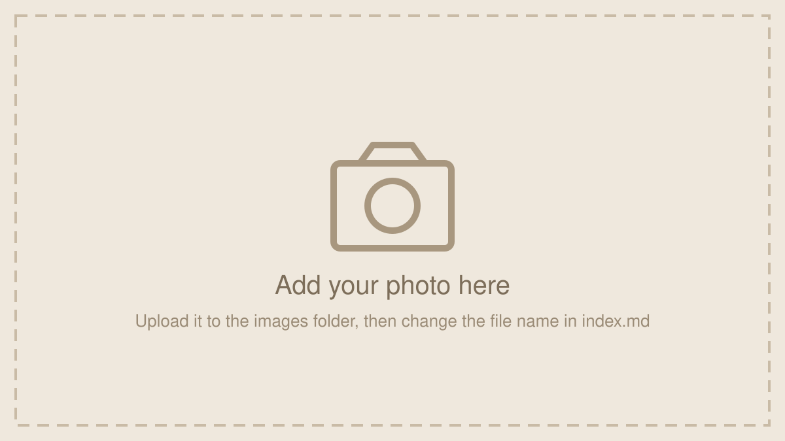

# Jallianwala Bagh: opinion piece website

The website for my RFLA 300 final project. It is built with GitHub Pages, so every change you save on GitHub goes live in about a minute.

## What's in here

| File | What it's for |
|---|---|
| `index.md` | **The article.** Almost all your editing happens here. |
| `images/` | Put your photos here. |
| `_config.yml` | Site title and your name. |
| `assets/css/style.css` | Colors and fonts (optional). |
| `_layouts/default.html` | Page template. You won't need to touch it. |

## Edit the article

1. Open `index.md` on GitHub and click the pencil icon (Edit).
2. Change the title, subtitle (`dek`) and `author` between the `---` lines at the top.
3. Write in plain text. Use `## ` for a section heading, `*italics*`, `**bold**` and `[link text](https://...)` for links.
4. As you finish each section, delete its yellow **Draft note** box (everything from `<div class="note"` to `</div>`).
5. Click **Commit changes**. Refresh the site after about a minute.

When you revise later, set the `updated:` date at the top (remove the `#` in front of it) so readers see it was updated.

## Add a picture

1. Open the `images` folder, then click **Add file → Upload files**, drag your photo in, and commit.
2. In `index.md`, find a block like this and change `placeholder.svg` to your file's name:

```html
<figure>
  
  <figcaption>Caption and photo credit.</figcaption>
</figure>
```

3. Write a short description in `alt` (for screen readers) and a caption with a photo credit.
4. To add another photo anywhere, copy and paste a whole `<figure>...</figure>` block.

**Photo tip:** use your own photos or ones you're allowed to reuse. Wikimedia Commons lists the license and the credit to give for each image.

## Change the color

In `assets/css/style.css`, change `--accent: #8a2c1d;` to any color code.
